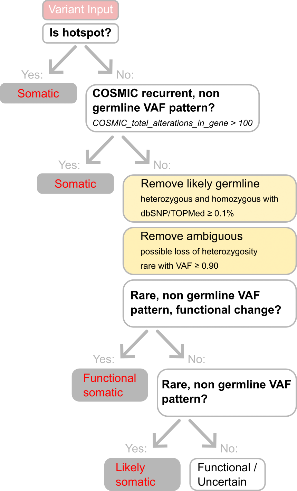

# Tumour-only somatic variant classifier, ver0.1.0

ver0.1.0 is the rule-based classifier (2026-04-10) used to separate somatic from germline variants in the VCU PDX
models, which were sequenced without a matched normal sample. Its input is one MAF file per model:
Mutect2 tumour-only calls, annotated with GATK Funcotator. Only PASS variants are classified.

## Rules

The rules are checked in order and the first one that matches decides the class.

Definitions:
- **VAF** (variant allele fraction) = alternative reads / (alternative + reference reads).
- **Population frequency** = dbSNP CAF and TOPMed allele frequency.
- **Rare** = both frequencies are below 0.1 % or absent.
- **Off-band** = VAF outside 0.35–0.65 (the range expected for a heterozygous germline variant) and below 0.90
  (the level expected for a homozygous germline variant).

| Step | Condition | Class |
|------|-----------|-------|
| 1 | Protein change is a known cancer hotspot | `somatic` |
| 2 | Gene has more than 100 alterations in COSMIC **and** VAF is off-band | `somatic` |
| 3 | Population frequency ≥ 0.1 % **and** VAF 0.35–0.65 | `germline` |
| 4 | Population frequency ≥ 0.1 % **and** VAF ≥ 0.90 | `germline` |
| 5 | Rare **and** VAF ≥ 0.90 (possible loss of heterozygosity) | `review_cn_loh` |
| 6 | Rare **and** coding or splice-site change **and** VAF off-band | `functional_uncertain_somatic` |
| 7 | Rare **and** VAF off-band | `likely_somatic` |
| 8 | Coding or splice-site change | `functional_uncertain` |
| 9 | Everything else | `uncertain` |

The classifier's somatic table holds `somatic` + `functional_uncertain_somatic` + `likely_somatic`. The counts in Figure 2b–c
(somatic variant density, cancer-associated genes) use class `somatic` only.

## Files

| File | Contents |
|------|----------|
| [classifier_v0.1.0.R](classifier_v0.1.0.R) | `classify_variants_mutect()` (the rules above) and its helpers `parse_popAF()`, `is_hotspot()`, `escape_regex()` |
| [filtering_workflow.png](filtering_workflow.png) | Diagram of the rules |
| [Hotspots_compiled.xlsx](Hotspots_compiled.xlsx) | Cancer hotspot list used by rule 1 (see [Hotspot list](#hotspot-list)) |

## Inputs

The script reads its two reference files from the working directory, so run it from this folder or copy the files
next to your own script.

| Input | Used for | Source |
|-------|----------|--------|
| Funcotator-annotated MAF per model (columns used include `Hugo_Symbol`, `Variant_Classification`, `Protein_Change`, `t_alt_count`, `t_ref_count`, `dbSNP_CAF`, `dbSNP_TOPMED`, `COSMIC_total_alterations_in_gene`) | Variants to classify | This study |
| `cancerGeneList.2026-03-27.tsv` | Cancer-gene annotation | [OncoKB Cancer Gene List](https://www.oncokb.org/cancer-genes), downloaded 2026-03-27. Not included: the OncoKB licence does not allow redistribution. Download it and save it under this name. |
| `Hotspots_compiled.xlsx` | Hotspot list for rule 1 | Included; compiled from [cancerhotspots.org](https://www.cancerhotspots.org/#/download) |

## Hotspot list

`Hotspots_compiled.xlsx` combines the hotspot tables downloaded from [cancerhotspots.org](https://www.cancerhotspots.org/#/download)
(Memorial Sloan Kettering Cancer Center). It has three sheets:

| Sheet | Contents | Rows |
|-------|----------|------|
| `V1_V2` | Single-residue and in-frame indel hotspots, versions 1 and 2 | 4,086 |
| `splice_site` | Splice-site hotspots from version 2 | 86 |
| `V3` | Newly identified hotspot residues, version 3 | 164 |

The classifier reads only the first sheet (`V1_V2`), because `read_excel()` opens the first sheet unless another is named.
Hotspots on the other two sheets are therefore not used by rule 1.

Sources:
- Version 1: Chang M. T., *et al.* Identifying recurrent mutations in cancer reveals widespread lineage diversity and mutational specificity. *Nature Biotechnology* 34, 155–163 (2016).
- Version 2: Chang M. T., *et al.* Accelerating discovery of functional mutant alleles in cancer. *Cancer Discovery* 8, 174–183 (2018).
- Version 3: Bandlamudi C., *et al.* (2026), Table S5, as listed on cancerhotspots.org.

Licence: the cancerhotspots.org data are released under the [Open Database License (ODbL) v1.0](https://opendatacommons.org/licenses/odbl/1-0/).
`Hotspots_compiled.xlsx` is a derived database and is shared under the same licence; if you reuse it, credit
cancerhotspots.org and the papers above.
