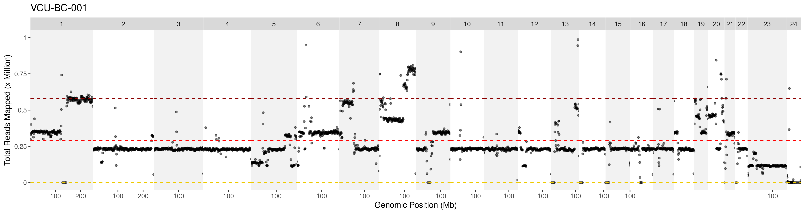

# Pan-cancer comparisons of multi-omics data for therapeutic selection

Nina Dashti-Gibson, Amy L. Olex, Katarzyna M. Tyc, Alexa M. Barber, Khoa L. A. Huynh, Oniya M. Smith, Bin Hu,
Praveen Bhoopathi, Mohammad Mikail I. Bala, Carson J. Walker, Dhanvin R. Yajaman, Rachel K. Myrick, AJ Sallee,
Nikitha Murugavel, Li Wang, Madhavi Puchalapalli, Anna E. Gibson, Grace R. Thompson, Vignesh Vudatha, Vashti L. Bandy,
Arunima Punjala, Harry D. Bear, Valentina Robila, Kandace P. McGuire, Rachit D. Shah, Leopoldo J. Fernandez,
Seung Duk Lee, Joaquin Reyna, Jinze Liu, Jennifer E. Koblinski, Mikhail G. Dozmorov, Nicholas T. Woods,
Jose G. Trevino, J. Chuck Harrell

*Journal, year, DOI: to be added.*

This folder contains the whole-genome sequencing (WGS) analyses of the VCU PDX models shown in Figures 2 and 3:
the tumour-only somatic variant classifier, and for each figure panel the table of plotted values and the script
that computed it.

## Contents

| Folder | What it holds |
|--------|---------------|
| [FigS2](FigS2) | Tumour-only somatic variant classifier ver0.1.0 (R code, filtering diagram, rules, hotspot list) |
| [Fig2](Fig2) | Tables and scripts for Figure 2 (human DNA content, somatic variant density, mutated cancer genes, oncoprint, Gini coefficient) |
| [Fig3](Fig3) | Tables and scripts for Figure 3 (genetic ancestry: PCA and ADMIXTURE) |
| [FigS3](FigS3) | Script for Supplementary Figure S3 (genome-wide coverage plot per sample) |

## Figure 2


| Panel | What is plotted | Table (TSV) | Script |
|-------|-----------------|-------------|--------|
| 2a | Human DNA (%) per model, by cancer type: 100 × `graft` / (`host` + `graft` + `ambiguous` + `both` + `neither`), from xengsort read classification (read counts summed over each model's sequencing libraries) | [Fig2a_FigS2a-xengsort_read_counts.tsv](Fig2/Fig2a_FigS2a-xengsort_read_counts.tsv) | — |
| 2b | High-confidence somatic variant density (somatic variants/Mb), by cancer type: somatic SNVs, insertions and deletions on chr1–22 in the classifier's highest-confidence tier (ver0.1.0 class `somatic`: known hotspots, or variants in genes with > 100 COSMIC alterations whose allele fraction is inconsistent with germline) / 2,875 Mb. Not equivalent to clinical tumour mutational burden (TMB). | [Fig2B-somatic_variant_density.tsv](Fig2/Fig2B-somatic_variant_density.tsv) | [Fig2b-somatic_variant_density_CAGs.R](Fig2/Fig2b-somatic_variant_density_CAGs.R) |
| 2c | Number of mutated cancer-associated genes, by cancer type | [Fig2C-CAGs.tsv](Fig2/Fig2C-CAGs.tsv) | [Fig2b-somatic_variant_density_CAGs.R](Fig2/Fig2b-somatic_variant_density_CAGs.R) |
| 2d | Oncoprint of somatic mutations in cancer genes (classifier ver0.1.0) | to be added | to be added |
| 2e | Gini coefficient of sequencing coverage, by cancer type | [Fig2e-g-Gini.tsv](Fig2/Fig2e-g-Gini.tsv) | [Fig2e-g-Gini.R](Fig2/Fig2e-g-Gini.R) |
| 2f–g | Gini coefficient, primary vs metastasis (colorectal, pancreatic) | [Fig2e-g-Gini.tsv](Fig2/Fig2e-g-Gini.tsv) | [Fig2e-g-Gini.R](Fig2/Fig2e-g-Gini.R) |

## Figure 3


| Panel | What is plotted | Table (TSV) | Script |
|-------|-----------------|-------------|--------|
| 3a–b | PCA of VCU PDX models projected onto 1000 Genomes Project (1KGP) samples, coloured by super-population (a) and population (b). PLINK output for 3,265 samples (3,202 1KGP + 63 VCU PDX samples: the 60 models plus 3 sequenced samples not in the cohort, which the scripts exclude). | [pruned_pca_results.eigenvec](Fig3/pruned_pca_results.eigenvec) (sample IDs + PC1–PC20), [pruned_pca_results.eigenval](Fig3/pruned_pca_results.eigenval) (eigenvalues of PC1–PC20), [20130606_g1k_3202_samples_ped_population.txt](Fig3/20130606_g1k_3202_samples_ped_population.txt) (1KGP sample labels: population and superpopulation) | [Fig3a-b-PCA.R](Fig3/Fig3a-b-PCA.R) |
| 3c | ADMIXTURE ancestry proportions per PDX model | [Fig3c-ADMIXTURE.tsv](Fig3/Fig3c-ADMIXTURE.tsv); ADMIXTURE inputs to the script: [pruned_merged_data.5.Q](Fig3/pruned_merged_data.5.Q) (ADMIXTURE output, K = 5: five ancestry proportions per sample) and [pruned_merged_data.fam](Fig3/pruned_merged_data.fam) (PLINK sample IDs, same order; 3,202 1KGP samples + 63 VCU PDX samples), [20130606_g1k_3202_samples_ped_population.txt](Fig3/20130606_g1k_3202_samples_ped_population.txt) (1KGP sample labels: population and superpopulation) | [Fig3c-ADMIXTURE_assignment.R](Fig3/Fig3c-ADMIXTURE_assignment.R) |

## Supplementary Figure S3

Genome-wide read coverage of each PDX model in 1-Mb bins. Example (VCU-BC-001):



Each point is one 1-Mb bin; chromosomes 1–22, X (23) and Y (24) are shown side by side. Dashed lines: zero (yellow),
the mean coverage across all bins (red) and twice the mean (dark red).

The coverage file is made with deepTools `bamCoverage` from each sample's sorted BAM file, and then plotted with [plot_genomewide_coverage.R](FigS3/plot_genomewide_coverage.R). The same bedGraph files
are the input for the Gini coefficient in Figure 2e–g.

```bash
conda activate deepTools

bamCoverage -b ${output}.sorted.bam -bs 1000000 -p 12 -o ${OUTPUT}/${SAMPLE_NAME}_deeptools_rmDupl.bedgraph -of bedgraph --ignoreDuplicates

conda deactivate

# Plot the results
module load R/4.4.1

Rscript plot_genomewide_coverage.R ${OUTPUT} ${SAMPLE_NAME}_deeptools_rmDupl.bedgraph
```

| Option | Meaning |
|--------|---------|
| `-bs 1000000` | bin size 1 Mb |
| `-p 12` | 12 threads |
| `-of bedgraph` | output format bedGraph (columns: chromosome, start, end, number of reads) |
| `--ignoreDuplicates` | reads with the same start position and orientation are counted once |

## Code and licensing

This directory contains code and analysis workflows developed by our group as part of our contribution to this collaborative study.

Materials authored by other contributors, third-party software, and dependencies remain subject to their respective copyright and license terms.

## Citation

If you use these analyses in academic work, please cite:

> "Pan-cancer comparisons of multi-omics data for therapeutic selection"
Nina Dashti-Gibson, Amy L. Olex, Katarzyna M. Tyc, Alexa M. Barber, Khoa L. A. Huynh, Oniya M. Smith, Bin Hu, Praveen Bhoopathi, Mohammad Mikail I. Bala, Carson J. Walker, Dhanvin R. Yajaman, Rachel K. Myrick, AJ Sallee, Nikitha Murugavel, Li Wang, Madhavi Puchalapalli, Anna E. Gibson, Grace R. Thompson, Vignesh Vudatha, Vashti L. Bandy, Arunima Punjala, Harry D. Bear, Valentina Robila, Kandace P. McGuire, Rachit D. Shah, Leopoldo J. Fernandez, Seung Duk Lee, Joaquin Reyna, Jinze Liu, Jennifer E. Koblinski, Mikhail G. Dozmorov, Nicholas T. Woods, Jose G. Trevino, J. Chuck Harrell
