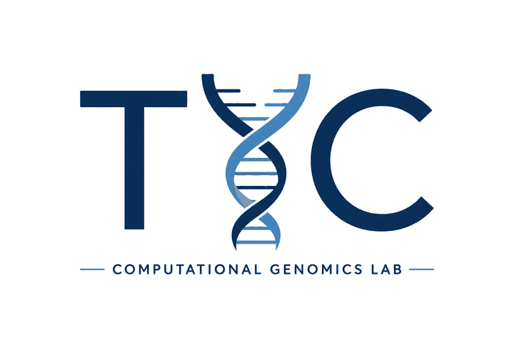

  

# TYC Computational Genomics Lab — code and data for publications

This repository collects code, analysis workflows, and relevant processed data developed by our group for published genomics studies, including both studies led by our group (**L**) and collaborative studies (**C**) to which we contributed analyses.

Each paper has its own folder. For published papers, a corresponding GitHub release provides a stable snapshot of the code and analyses associated with the publication.

| Year | Paper | Folder | Publication Release |
|------|-------|--------|---------------|
| 2026 **C** | Dashti-Gibson N., *et al.* Pan-cancer comparisons of multi-omics data for therapeutic selection. *Under review* | [2026_DashtiGibson_pancancer](2026_DashtiGibson_pancancer) | — |
| 2026 **L** | Tyc K. M., *et al.* Mutational landscape analysis of patient-derived xenograft models across multiple solid tumors and ancestries. *In preparation* | [2026_Tyc_PDX_WGS_landscape](2026_Tyc_PDX_WGS_landscape) | — |

**L** — Study led by our group  
**C** — Collaborative study to which our group contributed analyses

## How to use this repository

Open the folder of the paper you are reading. Its `README.md` lists select figure panels, the table (TSV) that holds the plotted values where relevant, and the script that computed that table.

## License

Unless stated otherwise in a paper folder or source file, code developed by our group in this repository is Copyright (c) 2026 Virginia Commonwealth University (VCU), Katarzyna M. Tyc, and is licensed under the [Creative Commons Attribution-NonCommercial 4.0 International License (CC BY-NC 4.0)](https://creativecommons.org/licenses/by-nc/4.0/); the full text is in [LICENSE](LICENSE). For commercial use, please contact us.

### Third-party and collaborative work

Third-party software and other materials, if listed, may be subject to separate license terms. Where applicable, those terms are identified in the corresponding paper directory or source files.

Use of this repository does not alter or supersede the licenses of third-party software or dependencies.

## Contact

For any questions or concerns about this repository, please contact 
**Katarzyna M. Tyc, PhD** — [katarzynatyc](https://github.com/katarzynatyc); [tyck@vcu.edu](mailto:tyck@vcu.edu)
